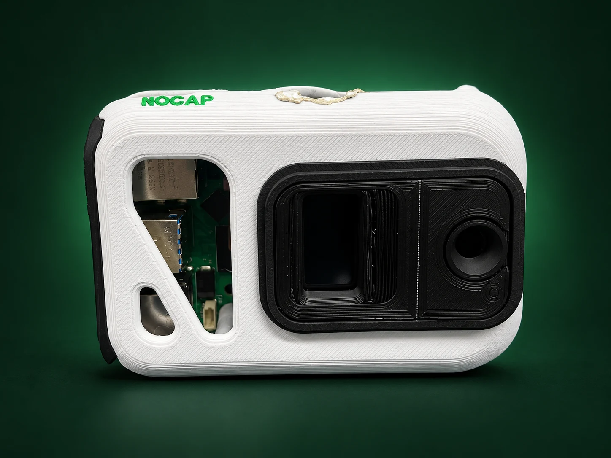
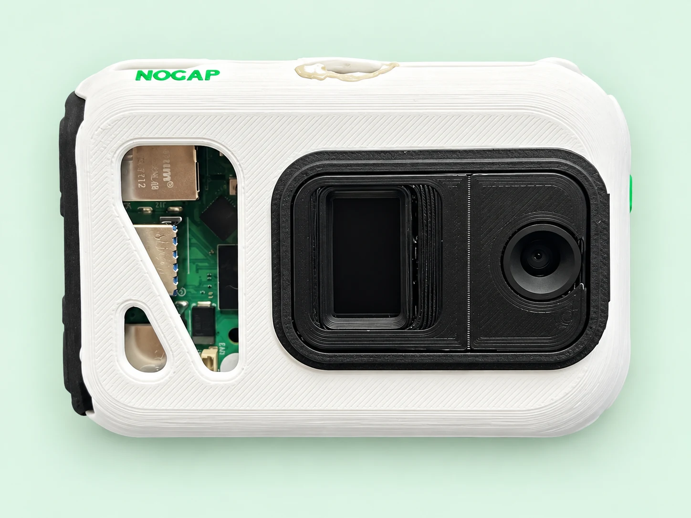

# NoCap — Proof, not vibes.

## The problem

Research papers can look convincing while their evidence is difficult to inspect.
A reference may not exist, a real source may not support the claim made about it,
and a published figure may be disconnected from the original lab data. When papers,
source files and review conversations live in different places, resolving those
questions becomes slow and hard to audit.

## The product

**NoCap is a pre-publication research integrity workspace** that brings papers,
source evidence and team review into one place. It helps researchers inspect three
questions: **Does the reference exist? Does it support the claim? Does the
underlying data support the result?** Findings guide human review; they are not an
automatic verdict on scientific correctness.

The software is the core product. One optional NoCap capture device connects lab
or field evidence to the workspace. Research teams can collect originals, assign
review work, discuss findings and keep an inspectable record of decisions.



*NoCap capture prototype — retouched photograph based on the supplied product photo.*

### From the bench to the paper

1. **Collect:** upload a research paper and retain supporting capture files with lab labels.
2. **Review:** inspect reference checks, evidence provenance and coverage gaps; assign findings to teammates.
3. **Document:** save reports, record review decisions and download the audit output.

| Part | What it does today |
| --- | --- |
| Research papers | Accepts PDF, DOCX, TXT, Markdown and TeX; extracts text and saves review reports. Default publication checks look up up to 12 DOI references. |
| Evidence studio | Displays source evidence and supports file comparison, record hashes and signature verification for correctly enrolled signed captures. |
| Team workbench | Tracks assignments, comments, review statuses and approval permissions. |
| Capture ingestion | Supports JPEG, PNG and MP4 uploads up to 50 MiB, with optional lab annotations. Unsigned uploads remain explicitly unverified. |
| Deeper analysis | Provider-backed analysis is optional and requires configuration; publication identity alone does not establish claim support. |

### Meet the capture prototype



*Top view — retouched prototype photograph, not a production render.*

The documented hardware design uses a **Raspberry Pi 5 and Camera Module 3**, with
push-to-talk notes and sensor measurements as intended capture inputs. The signing
implementation uses **SHA-256 hashes, Ed25519 signatures and chained records** to
help establish origin and detect changes. A valid signature does not establish
whether an experiment or conclusion is correct.

The workspace is designed around **one connected source**, with connection details
in Settings. Hardware voice/sensor capabilities and end-to-end physical-device
validation should not be inferred from the software demo. See the
[product content and photo provenance](docs/product-content-sources.md).

## Try the demo

[Open the NoCap Codespaces demo](https://glowing-potato-5wj6ww5654627r55-8501.app.github.dev/)

This is a temporary demonstration link: the Codespace and application must be
running, and port 8501 must be public for visitors. It uses a demo workspace with
synthetic evidence; it is not a permanent production deployment. If unavailable,
run the complete local demo below.

## Architecture

Streamlit frontend · authenticated FastAPI backend · SQLAlchemy persistence.
The local demo uses SQLite and local files; production adapters support PostgreSQL
and private S3 storage. Device credentials and workspace credentials are separate.
Secrets, local uploads and runtime data are excluded from Git.

## Start the complete local demo

```bash
git clone https://github.com/Bhargav072007/NOCAP-c0mpiled15.git
cd NOCAP-c0mpiled15
python3 -m venv .venv
.venv/bin/python -m pip install -r requirements-dev.txt -r requirements-cloud.txt
.venv/bin/python scripts/run_local.py
```

Open **http://localhost:8501** → **Sign in** → **Open local demo**. API documentation: http://localhost:8000/docs.
The dashboard stays on port8501 for IDE forwarding; API stays on loopback8000.
Ctrl+C stops both. Data persists in ignored `.runtime/`; the local demo uses a
random server-side admin token and clearly labeled synthetic evidence.

The workspace sections are Overview, Research papers, Evidence studio, Team workbench, and
Settings. There is no Devices tab or fleet counter. Settings shows one configured
NoCap source; set `NOCAP_DEVICE_ID` on the dashboard server when necessary. Reviews support assignment, statuses, approval permissions,
comments and conflict detection. Member additions create records, not emails.
Devices get scoped, revocable upload credentials; never a database password.

Test direct device-to-API transport with an explicitly unsigned local simulator:

```bash
.venv/bin/python scripts/simulate_device.py
```

Refresh Evidence studio. Source connection details are under Settings. The new capture is **DEMO · UNSUPPORTED**,
not falsely reported as cryptographically verified.

## Connect your real API

```bash
NOCAP_MODE=live NOCAP_SERVICE_DEMO=0 NOCAP_API=https://<approved-api-host> .venv/bin/streamlit run dashboard/app.py --server.address 127.0.0.1 --server.port 8501
```

Users sign in with their own expiring workspace tokens. Backend provisioning,
PostgreSQL TLS, S3 role configuration, migrations, signing/verifier plugin
contracts, device upload commands and scale limits are in
[docs/FULLSTACK.md](docs/FULLSTACK.md). No AWS resources or shared DB migrations
were applied. The API now uses the bundled Segment 3 verifier and Ed25519 signature checks.
Physical hardware, AWS acceptance and confirmed Sepolia anchoring remain untested.
See [the frontend/backend integration guide](docs/INTEGRATION.md) for manuscript review and provider setup.

For the original standalone fixtures without an API:

```bash
NOCAP_MODE=fixture .venv/bin/streamlit run dashboard/app.py --server.port 8501
```

Open Evidence studio. Team/device persistence requires the full-stack launcher.
The original ledger/anchor implementation and tests remain intact;
[legacy setup and P7 notes](docs/LEGACY_DASHBOARD.md) record the earlier handoff.
The new backend's anchor endpoint deliberately returns503 until the API owner
connects durable snapshot/transaction orchestration; it never invents a transaction.

## Validation and evidence

```bash
.venv/bin/python -m pytest -q
.venv/bin/python -m pip check
```

The UI-R2 browser review exercised landing/login, mobile navigation, file comparison,
citation results, review persistence, and a ledger download. Local synthetic data only.
The older FS1 browser scripts retain their historical five-section expectations;
they are not the current acceptance command.
Current evidence: [UI-R2 report](reports/UI-R2-product-interface.md),
[reports index](reports/README.md), and [context.md](context.md), which preserves
source requirements, new user decisions, milestone status and the change log.
This is a tested integration base, not a claim of measured high-scale production
readiness. No public deployment is claimed; source updates are published to this repository.

Public routes use Streamlit query parameters: `?page=home`, `?page=login`, and
`?page=workspace`. A direct workspace URL requires an authenticated session or an
explicit local-demo entry. Sign out clears session state. Production entry validates
a personal token against `/me`; this is not an email/password or SSO implementation.

### Motion update

The interface now includes ten component animations and one continuous colour ribbon.
Use its pause control, or Settings → Display & refresh preferences → Reduce motion.
System reduced-motion preferences are also respected. [Motion report](reports/UI-M1-motion.md).

### Interactive workflow preview

The landing page now has a 3D capture → review → export tour. Select a step, use
arrow keys, or pause the full scene. The preview uses clearly labelled sample data;
**Try the workspace** opens the existing access flow. [UI-M2 report](reports/UI-M2-dynamic-demo.md).

## Segment 3 verifier

The repository also includes the hybrid verifier. See [verifier setup and usage](docs/VERIFIER.md) and [its validation report](VALIDATION.md). Its existing source, tests, fixtures, and dependency lock are preserved. The dashboard now calls the authenticated API for text/document review, linked capture checks and saved full reports. Local client/API/verifier integration is tested; external model calls are separately configured. `requirements.txt` includes both components; the existing lockfiles record their separate validation environments.

Luminal Flash has been reworked and live-tested for the Segment 3 verifier. It defaults to final-answer JSON mode with local schema/evidence validation. See [verifier setup](docs/VERIFIER.md#luminal-provider--reworked-and-live-tested) and [validation](VALIDATION.md). The tested scientific fixture completes; the current dashboard integration has local and mocked-provider coverage, not a new live-provider accuracy evaluation.

## Source images, videos and lab labels

See [device ingestion and AWS handoff](docs/DEVICE_INGESTION.md) for signed uploads,
file-only gateway compatibility, 50 MiB limits, image/video processing and the
current deployed-endpoint verification boundary.

### Research-paper uploads

Open **Research papers** in the sidebar. Upload a PDF/DOCX/TXT/Markdown/TeX file
(up to 25 MiB and 200,000 extracted characters), then select **Review paper**.
The default paper/publication mode checks local evidence and looks up up to 12
DOI references. It does not require an AI key. References without a DOI or beyond
that limit remain explicitly unassessed. Publication identity is separate from
claim support and scientific correctness. Full provider-backed scientific analysis
remains optional and supports up to 50,000 characters. Scanned PDFs need OCR text.
Reports show extraction counts, findings, coverage gaps and a downloadable audit.
